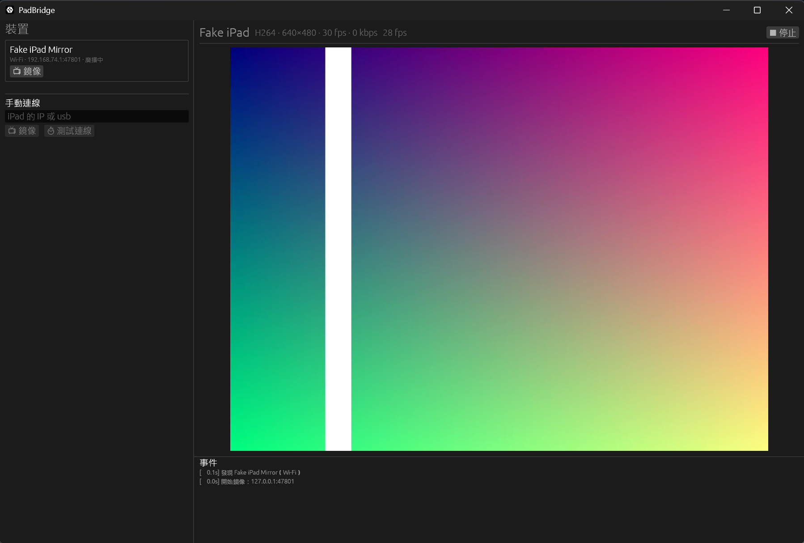

# PadBridge

開源的 iPad ⇄ Windows 畫面共享工具，USB 有線與 Wi‑Fi 無線都能用。

- **延伸螢幕（Display）**：iPad 當 Windows 的延伸或鏡像螢幕，支援觸控、Apple Pencil（壓力、傾斜、懸停）與巧控鍵盤觸控板。
- **鏡像（Mirror）**：iPad 畫面即時顯示在 Windows 視窗中。

兩個方向都已在實機（iPad + Windows 11）上以 USB 與 Wi‑Fi 驗證，鏡像可達 60 fps。架構與協定見 [docs/DESIGN.md](docs/DESIGN.md)。



## 功能

- **自動找到 iPad**：USB 接上的 iPad 透過 usbmux 出現；同一網路上的 iPad 透過 Bonjour 出現。
- **真正的延伸螢幕**：沒有虛擬螢幕時，App 會提供「安裝虛擬螢幕」按鈕（開源的 [Virtual Display Driver](https://github.com/VirtualDrivers/Virtual-Display-Driver)），並在連線時自動把虛擬螢幕調成 iPad 的解析度。
- **硬體編解碼**：延伸螢幕用 GPU 縮放加 Media Foundation 硬體 H.264 編碼；鏡像用硬體 H.264 解碼，GPU 同時完成裁切、旋轉與色彩轉換。
- **選擇 GPU**：同時有內顯與獨顯的電腦，可以分別指定編碼和解碼要用哪張顯示卡，或改用 CPU。
- **低延遲**：只在畫面變動時編碼；游標由 iPad 自己繪製；接收端跟不上時只顯示最新一格，延遲不會累積。
- **狀態顯示**：鏡像視窗顯示「顯示 fps／收到 fps／流量／解碼時間」，方便判斷瓶頸。

## 安裝

### Windows

1. 安裝 **iTunes**（Apple 官網的桌面版）或 Microsoft Store 的「**Apple 裝置**」App。USB 連線需要它提供的 Apple Mobile Device Service。
2. 從 [Actions](https://github.com/ynyrworks/padbridge/actions) 最新一次成功的建置下載 `PadBridge-windows`，解壓後執行 `PadBridge.exe`。裡面也有命令列版 `padbridge-cli.exe` 與授權檔。
3. 第一次執行時，Windows 防火牆可能會詢問，請允許「私人網路」（Bonjour 需要）。

### iPad（不需要 Mac）

1. 從同一次建置下載 `PadBridge-unsigned-ipa`。
2. 在 Windows 用 [Sideloadly](https://sideloadly.io/) 搭配自己的 Apple ID 簽章，透過 USB 安裝到 iPad。免費 Apple ID 每 7 天要重簽一次。
3. 在 iPad 上：
   - 「設定 → 一般 → VPN 與裝置管理」信任你的開發者描述檔；
   - 「設定 → 隱私權與安全性 → 開發者模式」開啟；
   - 打開 PadBridge，允許「區域網路」權限。

## 使用

### 延伸螢幕（Windows → iPad）

1. iPad 打開 PadBridge App，保持在前景。
2. Windows 的 PadBridge 選擇「傳送到 iPad 的螢幕」，按該 iPad 的「🖥 延伸螢幕」。
3. 直接在 iPad 上操作：手指是觸控，Apple Pencil 是筆，觸控板是滑鼠。可取消勾選「允許 iPad 操作」。

如果選的是實體螢幕，iPad 會鏡像那個螢幕。要多一個真正的延伸螢幕：

1. 按左側的「⬇ 安裝虛擬螢幕」。PadBridge 會用 winget 下載 Virtual Display Driver 的控制程式並開啟。
2. 在控制程式按 **Install Driver**，允許系統管理員權限。驅動由上游作者簽章與安裝；公司管理的電腦可能不允許安裝驅動。
3. 回到 PadBridge 按 🔄，選擇標示「虛擬」的螢幕。連線時 PadBridge 會把它調成 iPad 的解析度。

以系統管理員身分執行的視窗（例如工作管理員）收不到 iPad 的觸控，這是 Windows 的安全限制。

### 鏡像（iPad → Windows）

1. 在 iPad 的 PadBridge App 點「開始 / 停止廣播」，或從控制中心長按「螢幕錄影」，選 **PadBridge Mirror** 開始廣播。畫面不會被錄成檔案，只會即時傳送。
2. Windows 的 PadBridge 按「📺 鏡像」。

### 編碼 / 解碼

左側「編碼 / 解碼」可以分別選擇：

| 選項 | 延伸螢幕編碼 | 鏡像解碼 |
|---|---|---|
| 自動（預設） | 用繪製該螢幕的 GPU，不需額外複製 | 硬體解碼，獨顯優先 |
| 指定 GPU | 若不是繪製該螢幕的 GPU，每格會經過系統記憶體複製一次 | 用該 GPU 硬體解碼 |
| CPU | OpenH264 軟體編碼 | OpenH264 軟體解碼 |

硬體無法使用時會自動改用 CPU，原因會寫在事件紀錄。

### 效能參考

| 項目 | 硬體 | 軟體（CPU） |
|---|---|---|
| 延伸螢幕：4K / 1440p → 1080p 編碼 | 約 2 ms／格（RTX 5080） | 4K 約 18 fps，1440p 約 38 fps |
| 鏡像：1334×1920 解碼＋旋轉＋轉色 | 約 3.8 ms／格（RTX 5080） | 約 12 ms／格（解碼 8.4 ms＋轉換 3.4 ms） |

實機鏡像（RTX 3050 Laptop，軟體解碼）：iPad 送 60 fps，Windows 顯示約 60 fps。

## 命令列

```bash
padbridge-cli devices
```

```bash
padbridge-cli ping usb
```

```bash
padbridge-cli monitors
```

```bash
padbridge-cli gpus
```

```bash
padbridge-cli display usb 1
```

```bash
padbridge-cli mirror usb
```

`<目標>` 可以是 `usb`、`usb:<UDID>` 或 iPad 的 IP。`PadBridge.exe --mirror usb` / `--display usb` 會在啟動後立刻開始，適合做成捷徑。

## 開發

需要 Rust（stable）與 Windows 10 1809+ / Windows 11。

```bash
cargo test
```

```bash
cargo run --release -p padbridge-app
```

需要 GPU 的測試預設略過，可以這樣執行：

```bash
cargo test --release -p padbridge-host -- --ignored hardware run_mirror_hardware upload_then_encode bench_hardware --nocapture
```

沒有 iPad 也能測試：

```bash
cargo run --release -p padbridge-host --example fake_display
```

```bash
cargo run -p padbridge-host --example fake_mirror
```

iOS 端由 GitHub Actions 的 `ios` job 以 XcodeGen 產生專案、跑 Swift 測試並產出未簽章 IPA。有 Mac 的話，可以在 `ios/` 執行 `xcodegen generate` 後用 Xcode 開啟。

## 已知限制

- 免費 Apple ID 簽的 App 7 天後失效，需要重簽。
- 鏡像需要每次手動開始廣播，這是 iOS 的限制。
- iPad 端目前輸出 H.264 Constrained Baseline；HEVC 與 High profile 尚未支援。
- 從原始碼編譯的 OpenH264 不在 Cisco 的 H.264 專利授權範圍內，詳見 [THIRD_PARTY_NOTICES.md](THIRD_PARTY_NOTICES.md)。

## 授權

PadBridge 以 [MIT](LICENSE) 授權。第三方元件（OpenH264、egui 字型、Rust crates、Virtual Display Driver 等）的授權與來源見 [THIRD_PARTY_NOTICES.md](THIRD_PARTY_NOTICES.md)，全文在 [`licenses/`](licenses/)。

## 致謝

- [Virtual Display Driver](https://github.com/VirtualDrivers/Virtual-Display-Driver)：Windows 虛擬螢幕。
- [OpenH264](https://github.com/cisco/openh264) 與 [openh264-rs](https://github.com/ralfbiedert/openh264-rs)：軟體 H.264。
- [egui / eframe](https://github.com/emilk/egui)：Windows App 介面。
- [libimobiledevice](https://libimobiledevice.org/) 與 [peertalk](https://github.com/rsms/peertalk)：usbmux 協定的參考。
